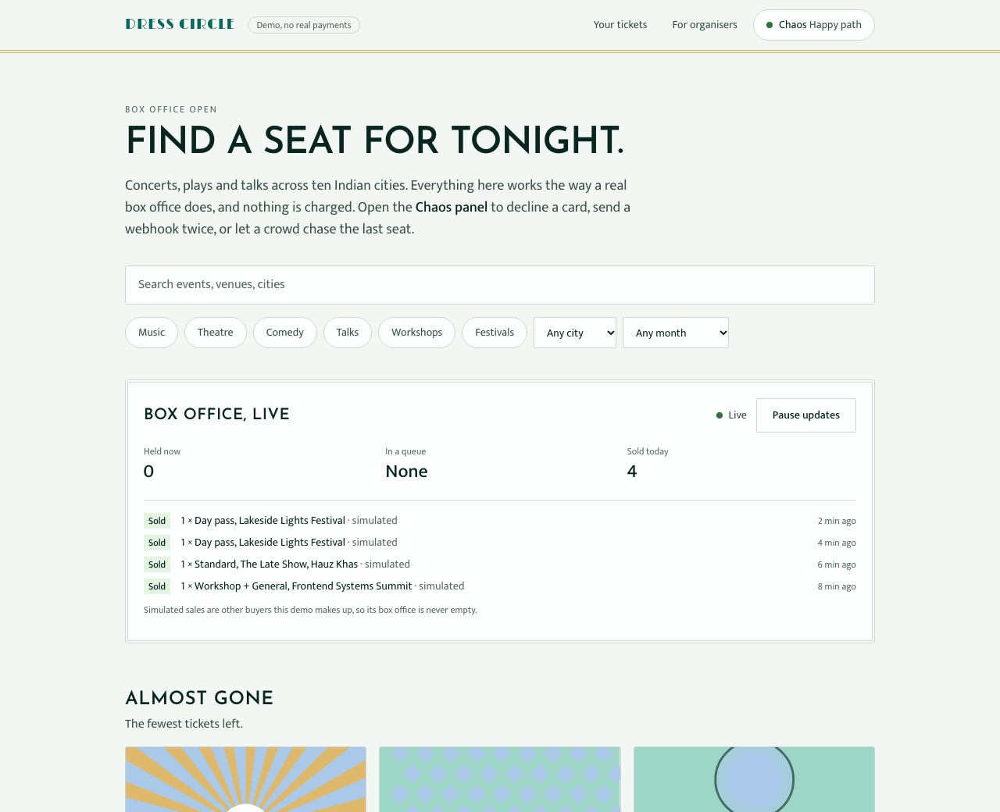
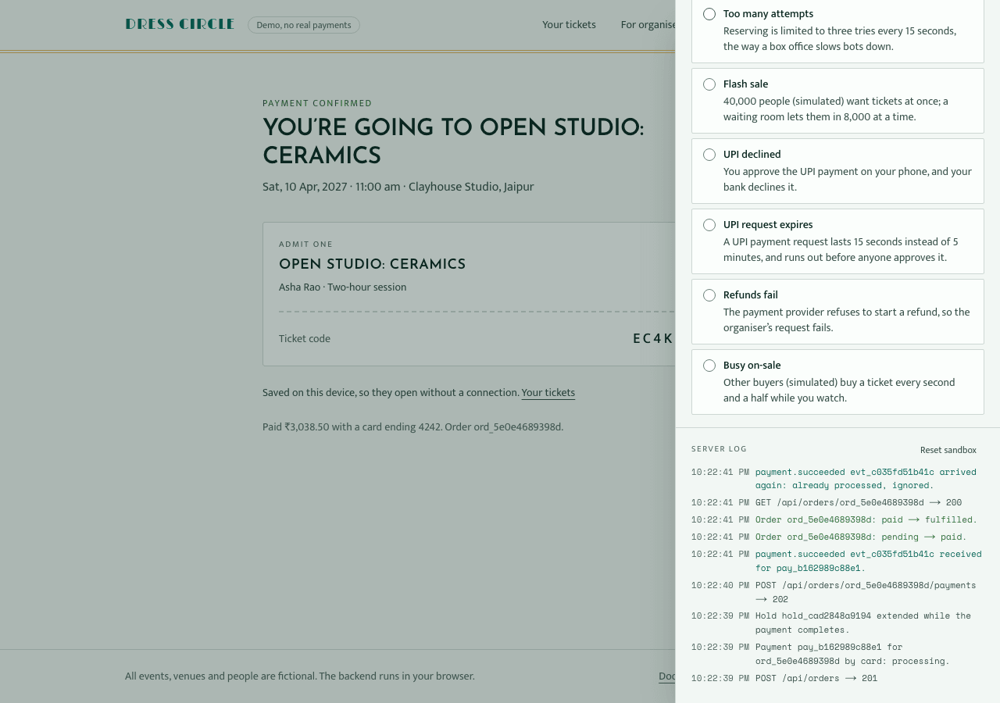
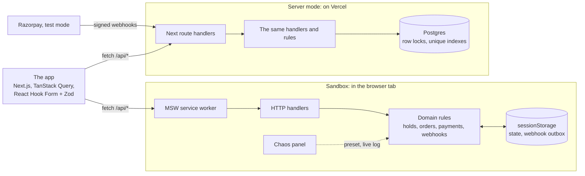
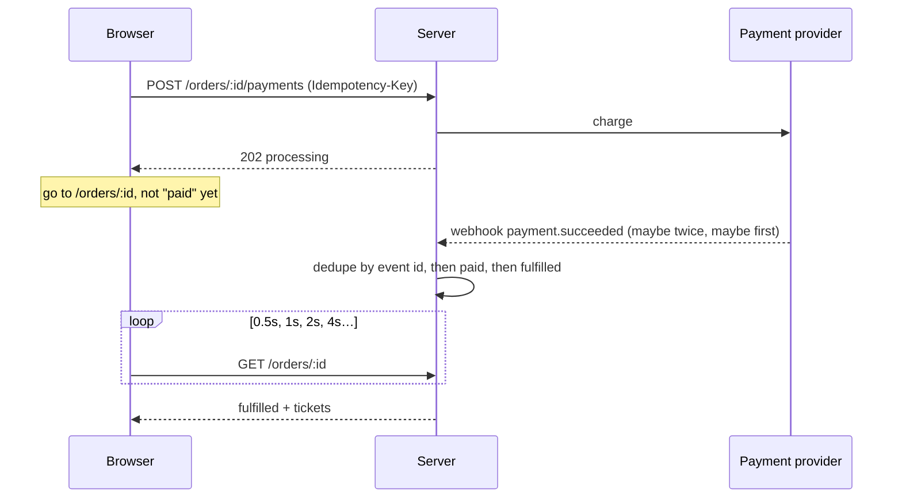

# Dress Circle

[](https://github.com/kzs2501/dresscircle/actions/workflows/ci.yml)
[](LICENSE)
[](https://kzs2501.github.io/dresscircle/)

**A ticket box office you can try, and break on purpose.** Seat maps, a fair flash-sale
queue, card and UPI, tickets that open offline, and a chaos panel that makes payments
fail while the server log explains why. Formerly admit-one
([why the name changed](docs/decisions/021-renamed-dress-circle.md)).

**[Try the sandbox](https://dresscircle.vercel.app)**: no sign-up, no keys, no real
payments. The backend runs in your browser, so your sandbox is yours alone.
**[Server mode](https://dresscircle-server.vercel.app)**: the same app on Postgres,
taking payment through Razorpay's test mode.
**[The catalogue](https://kzs2501.github.io/dresscircle/)**: the components and the states
they can be in, in Storybook. Stories that fetch data run on the same in-browser backend.



## Contents

- [Where to look](#where-to-look)
- [Try it](#try-it)
- [How it works](#how-it-works)
- [Running it](#running-it)
- [Quality](#quality)
- [Documentation](#documentation)
- [Known limits](#known-limits)
- [Licence](#licence)

## Where to look

Each hard part, and the files to open first. [The hard parts](docs/hard-parts.md) tell
each story in full, and [the decision records](docs/decisions/) say why.

| Hard part                                                                                                                   | Start with                                                                                                                                                                                 |
| --------------------------------------------------------------------------------------------------------------------------- | ------------------------------------------------------------------------------------------------------------------------------------------------------------------------------------------ |
| 1. [Holds that can't oversell](docs/hard-parts.md#1-holds-that-cant-oversell-and-expire-without-a-timer)                    | [`inventory.ts`](src/backend/domain/inventory.ts) · [`stock.ts`](src/backend/postgres/stock.ts)                                                                                            |
| 2. [A checkout driven by the URL](docs/hard-parts.md#2-a-typed-step-registry-driven-by-the-url)                             | [`step-registry.ts`](src/features/checkout/domain/step-registry.ts) · [`[step]/page.tsx`](src/app/checkout/%5BholdId%5D/%5Bstep%5D/page.tsx)                                               |
| 3. [The webhook decides, not the redirect](docs/hard-parts.md#3-the-webhook-not-the-redirect-decides)                       | [`payments.ts`](src/backend/domain/payments.ts) · [`webhooks.ts`](src/backend/domain/webhooks.ts) · [`use-order-status.ts`](src/features/orders/hooks/use-order-status.ts)                 |
| 4. [Payment after the hold expired](docs/hard-parts.md#4-payment-after-the-hold-expired)                                    | [`order-machine.ts`](src/backend/domain/order-machine.ts)                                                                                                                                  |
| 5. [A seat map you can use with a keyboard](docs/hard-parts.md#5-a-seat-map-you-can-use-with-a-keyboard)                    | [`seat-grid.ts`](src/features/events/domain/seat-grid.ts) · [`seat-grid.tsx`](src/features/events/components/seat-map/seat-grid.tsx) · [`seating.ts`](src/backend/domain/seating.ts)       |
| 6. [A waiting room, and a limit on trying](docs/hard-parts.md#6-a-waiting-room-and-a-limit-on-trying)                       | [`queue.ts`](src/backend/domain/queue.ts) · [`waiting-room.tsx`](src/features/queue/components/waiting-room.tsx) · [`rate-limit.ts`](src/backend/http/rate-limit.ts)                       |
| 7. [All-in prices, GST included](docs/hard-parts.md#7-the-price-you-see-is-the-price-you-pay)                               | [`pricing.ts`](src/core/pricing.ts)                                                                                                                                                        |
| 8. [UPI, settled by webhook](docs/hard-parts.md#8-upi-approved-in-another-app-settled-by-webhook)                           | [`upi.ts`](src/backend/domain/upi.ts) · [`use-upi-payment.ts`](src/features/checkout/hooks/use-upi-payment.ts)                                                                             |
| 9. [Organisers' access, checked twice](docs/hard-parts.md#9-an-organisers-dashboard-with-access-checked-twice)              | [`access.ts`](src/backend/domain/access.ts)                                                                                                                                                |
| 10. [Eleven thousand orders in a real table](docs/hard-parts.md#10-eleven-thousand-orders-in-a-table-that-stays-a-table)    | [`reporting.ts`](src/backend/domain/reporting.ts) · [`orders-table.tsx`](src/features/organiser/components/orders-table.tsx)                                                               |
| 11. [Refunds, optimistic and honest](docs/hard-parts.md#11-refunds-optimistic-and-honest)                                   | [`refunds.ts`](src/backend/domain/refunds.ts) · [`use-refund.ts`](src/features/organiser/hooks/use-refund.ts)                                                                              |
| 12. [Every state in a catalogue, every pixel checked](docs/hard-parts.md#12-every-state-in-a-catalogue-every-pixel-checked) | [`sandbox.ts`](.storybook/sandbox.ts) · [`stories.spec.ts`](visual/stories.spec.ts)                                                                                                        |
| 13. [The same API on Postgres](docs/hard-parts.md#13-the-same-api-on-postgres-and-races-the-database-cant-lose)             | [`unit-of-work.ts`](src/backend/postgres/unit-of-work.ts) · [`stock.ts`](src/backend/postgres/stock.ts) · [`buyer-contract.ts`](src/backend/testing/buyer-contract.ts)                     |
| 14. [Tickets that work in a basement](docs/hard-parts.md#14-tickets-that-work-in-a-basement)                                | [`ticket-token.ts`](src/core/ticket-token.ts) · [`wallet.ts`](src/lib/wallet.ts) · [`sw.js`](public/sw.js) · [`check-ticket.ts`](src/features/scanner/domain/check-ticket.ts)              |
| 15. [A real payment provider (Razorpay)](docs/hard-parts.md#15-a-real-payment-provider-and-money-that-cant-stay)            | [`provider-payments.ts`](src/backend/domain/provider-payments.ts) · [`signatures.ts`](src/backend/razorpay/signatures.ts)                                                                  |
| 16. [A box office first](docs/hard-parts.md#16-a-box-office-first-the-system-underneath)                                    | [`page.tsx`](src/app/page.tsx) · [`activity.ts`](src/backend/domain/activity.ts) · [`event-filters.ts`](src/features/events/domain/event-filters.ts)                                       |
| 17. [Search in your own words, for free](docs/hard-parts.md#17-search-in-your-own-words-for-free)                           | [`event-query.ts`](src/features/events/domain/event-query.ts) · [`plan.ts`](src/lib/ai/plan.ts) · [`route.ts`](src/app/ai/plan/route.ts)                                                   |
| 18. [An assistant that never sees the data](docs/hard-parts.md#18-an-assistant-that-never-sees-the-data)                    | [`question.ts`](src/features/organiser/domain/question.ts) · [`answers.ts`](src/features/organiser/domain/answers.ts) · [`assistant.tsx`](src/features/organiser/components/assistant.tsx) |

## Try it

Open the **Chaos** panel (top right), pick a scenario, then buy a ticket. Each scenario
is also an end-to-end test that checks both what you see and what the server recorded.

| Scenario                   | What happens                                           | What a correct checkout does                                                     |
| -------------------------- | ------------------------------------------------------ | -------------------------------------------------------------------------------- |
| Happy path                 | Realistic latency, and simulated buyers now and then   | Confirming… for a moment, then tickets                                           |
| Declined card              | The bank says no                                       | Inline error, details kept, retry with another card                              |
| 3-D Secure                 | The bank wants authentication                          | A challenge dialog; it survives a page refresh                                   |
| Slow network               | Every request takes ~3 s                               | Loading states; a double-click reserves once and pays once                       |
| Connection drops           | The payment's answer is lost; then a few status checks | Paying again replays the first answer (one charge); the page keeps what it knows |
| Webhook arrives twice      | At-least-once delivery                                 | One set of tickets; the duplicate is logged and ignored                          |
| Webhook before redirect    | The provider beats your browser                        | The order page opens already confirmed                                           |
| Webhook delayed            | 12 s before confirmation                               | Polling that backs off, then a reassuring note                                   |
| Hold expires mid-payment   | Payment lands after the hold is gone                   | A full refund, explained in plain words                                          |
| Crowd buys the last ticket | Someone else gets there first                          | "Just missed it", live availability, never oversold                              |
| Seat snatched              | Someone takes one of your chosen seats first           | Nothing held; the lost seat is named and the rest stay chosen                    |
| Too many attempts          | Reserving limited to 3 tries every 15 s                | A 429 with Retry-After; Reserve counts down, then works                          |
| Flash sale                 | 40,000 people (simulated) arrive at once               | A waiting room: your place, an honest wait, your turn announced                  |
| UPI declined               | You approve on your phone; your bank says no           | The webhook says so; a focused notice, nothing taken, pay by card instead        |
| UPI request expires        | A 15-second request nobody approves                    | The request runs out, the page says so, and a new one can be asked for           |
| Busy on-sale               | Other buyers take a ticket every 1.5 s                 | The organisers' dashboard updates live, and the orders table doesn't jump        |
| Refunds fail               | The provider refuses to start a refund                 | "Refund pending" rolls back, and a focused alert says why                        |

Test cards work too: `4242…` succeeds, `4000 0000 0000 0002` is declined,
`4000 0025 0000 3155` asks for 3-D Secure. Or pay by UPI, and approve or decline on the
simulated phone that appears below the checkout.



## How it works

The app talks to its backend only over HTTP, so the same code runs against two backends:
one in your browser, and one on a server. The same contract tests pass against both.



The backend (`src/backend/`) is plain TypeScript with an injectable clock, so every rule
is unit-tested without a browser. The layers, and the lint rules that enforce them, are
in [docs/architecture.md](docs/architecture.md). A payment, start to finish:



### Why the backend runs in the browser

So anyone can run the demo with zero setup, every visitor gets an isolated sandbox, and
the chaos panel can genuinely control the server. MSW runs handlers in the page, so the
server's state (including webhooks still waiting to be delivered) is persisted to
sessionStorage and resumes after a reload: the outbox pattern.

**What the sandbox doesn't exercise:** true multi-client concurrency. In the browser the
backend is single-threaded, so a hold is atomic by construction, and contention is
simulated by a crowd of bot buyers. Server mode exercises the real thing: the same API
on Postgres, where the database itself refuses an oversold tier or a seat held twice
([hard part 13](docs/hard-parts.md#13-the-same-api-on-postgres-and-races-the-database-cant-lose)). The default build never loads it.
([decision](docs/decisions/001-simulated-backend.md))

## Running it

```bash
npm install
npm run dev          # http://localhost:3000
npm test             # unit, component and HTTP tests
npm run storybook    # the component catalogue, http://localhost:6006
npm run build && npm run test:e2e
```

No environment variables, keys or accounts needed. Buy a ticket, open **Your tickets**,
turn the network off, and it's still there; the **Door scanner** (in the footer) checks
it, by camera or by a photo of it.

**Server mode,** on Postgres (installed by npm; nothing else to set up):

```bash
npm run db:up && npm run db:migrate   # a throwaway Postgres on port 54329, migrated
npm run dev:server                    # the app, against it
npm run test:server                   # the server backend against real Postgres
npm run build:server && npm run test:e2e:server
npm run build:razorpay && npm run test:e2e:razorpay   # paying through a stand-in Razorpay
npm run db:down
```

To pay through Razorpay's real test mode, set `RAZORPAY_KEY_ID`, `RAZORPAY_KEY_SECRET`
and `RAZORPAY_WEBHOOK_SECRET` (test keys only; the key id at build too) and run
`npm run dev:server`. Webhooks can't reach a laptop, but Checkout's signed result settles
the payment all the same.

## Quality

| Check                        | What it covers                                                                                                                                                                                             |
| ---------------------------- | ---------------------------------------------------------------------------------------------------------------------------------------------------------------------------------------------------------- |
| `npm run lint` + `typecheck` | Strict TypeScript and type-aware ESLint: naming conventions, exhaustive switches, and the layer boundaries                                                                                                 |
| `npm test`                   | 844 unit, component and HTTP-contract tests, with coverage floors per layer (`npm run test:coverage`); among them, every link in the README and docs, and one Node.js major for this laptop, CI and Vercel |
| `npm run test:server`        | 93 tests against real Postgres: concurrent holds and payments, idempotency across processes, signed webhooks, retries                                                                                      |
| `npm run eval:ai`            | 33 searches and 30 organisers' questions, scored field by field; the rules alone read 85% and 93% exactly right (97% and 93% with the free model), and CI holds them to 80% and 85%                        |
| `npm run test:stories`       | 131 stories, each a test in Chromium: it renders, passes its play function, and has no axe violations                                                                                                      |
| `npm run test:visual`        | 310 screenshots, in light, dark and at 375 px, compared in Playwright's Linux image on arm64                                                                                                               |
| `npm run test:e2e`           | 111 browser tests, one per chaos scenario and many more; 36 also run in server mode, and 4 pay through a stand-in Razorpay                                                                                 |
| `npm run test:e2e:perf`      | Choosing seats and filtering 11,000 orders stay under 200 ms with the CPU slowed four times                                                                                                                |
| `npm run lhci`               | Lighthouse on desktop: 100 in all four categories on every buyer's page                                                                                                                                    |
| `npm run lhci:mobile`        | On a mid-range phone: 95, 95 and 93 for performance in CI, and under 420 KB of script                                                                                                                      |

What each suite covers in detail, and notes on accessibility and money:
[docs/quality.md](docs/quality.md).

## Documentation

- [The hard parts](docs/hard-parts.md): sixteen problems, each solved properly
- [Architecture](docs/architecture.md): the layers, and the lint rules that keep them apart
- [API](docs/api.md): every endpoint, its errors, and what may be cached
- [Conventions](docs/conventions.md): naming and code style
- [Quality](docs/quality.md): what each test suite covers
- [Decision records](docs/decisions/): twenty-four, from the simulated backend to the scheduler that keeps time
- [Contributing](CONTRIBUTING.md): the checks, commit conventions and review checklist
- [Security](SECURITY.md): the threat model, and how to report a vulnerability

```
src/
  app/              routes, error boundaries, providers; /problems documents every error type
  features/         events · checkout · orders · queue · organiser · sandbox · tickets · scanner: view-model hooks and their components
  components/ui/    design-system primitives (Button, TextField, Notice, ErrorState, …)
  lib/              API client, query factories, routes, safe storage, formatting, the wallet,
                    the door's keys, scan log and QR reader, the service worker's registration
  contract/         the HTTP contract: routes, DTO and request schemas, problem types
  core/             the shared kernel: catalogue, pricing and GST, statuses, validation
  backend/          the service: domain, HTTP adapter, the in-browser runtime and chaos presets,
                    and the server backend on Postgres (backend/postgres, backend/server.ts)
  instrumentation-client.ts   starts the backend before the app is interactive
public/sw.js        the one service worker: offline pages, then MSW's for the sandbox
docs/               architecture, conventions, API, and decision records
e2e/                Playwright, with page objects in fixtures.ts; config/ holds the server,
                    Razorpay and screenshot runs
lighthouse/         the Lighthouse budgets, desktop and mobile
drizzle/            SQL migrations for server mode, generated from the schema
.storybook/         the catalogue's config, and the sandbox each story runs on
visual/             screenshot tests of every story, and their baselines
```

## Known limits

Choices made on purpose, and what each one costs:

- **The rate limit knows a client by its IP,** from a header a trusted proxy sets
  (Vercel's `x-forwarded-for`). Behind no such proxy it can't tell clients apart, so it
  doesn't limit, and says so at start-up. Many buyers behind one address share a
  limit.
- **An order's id is its key.** Anyone with an order's link sees it and its tickets,
  as with most ticket links. A server's ids carry 60 random bits; buyer accounts
  would replace this.
- **Reads never write.** Availability leaves expired holds out, and the next hold for
  the event releases their stock; there's no timer to miss.
- **Migrations run from a workstation** (`npm run db:migrate`, with `drizzle-kit` a
  development dependency), not on deploy.
- **A door learns of a refund at its next sync,** and two doors offline each let a
  copied ticket in once. Each door says how old its list of refunds is.
- **Best available bends the single-seat rule** for the last seats in a tier only:
  they're sold, not refused.
- **One currency per organiser,** which the catalogue's tests hold every event to, so
  revenue is one sum.
- **The lock order is argued, not tested.** Deadlocks between holds didn't reproduce in
  tests, so the retries that would recover from one are tested directly.
- **In a sale with a waiting room,** the ticket choices show for a moment before the
  queue replaces them. Nothing can be chosen in between: the choices wait for the same
  answer that decides the queue.
- **The simulated 3-D Secure check** can be approved by whoever has the payment's id:
  it stands in for the bank's page, in the sandbox. Server mode pays through Razorpay,
  whose check runs at the card's issuer.
- **Razorpay in test mode only:** the server refuses live keys. What Checkout offers
  (cards, net banking, wallets, UPI) is the Razorpay account's to say.
- **The organisers' dashboard and the waiting room** run in the sandbox only.

## Not in v1

Buyer accounts, emails, real authentication, live payments, organisers' refunds through
Razorpay (the dashboard runs in the sandbox), and door scanners that share what they've
seen (each remembers only its own scans).

## Licence

[MIT](LICENSE). Built by [Kshitiz Sonakiya](https://github.com/kzs2501). All events, venues and
people are fictional.
